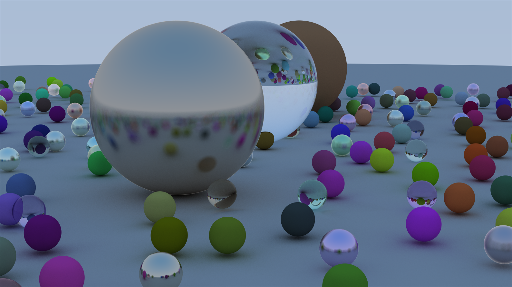

# Vulkan compute shader Ray Tracer
---


GPU-accelerated ray tracing renderer implemented in **C++ and Vulkan**, using compute shaders to perform ray generation, scene intersection, shading, and image output.

The renderer performs a single compute pass to generate a ray-traced image and presents the resulting static image in a GLFW window. The rendering and resource management are handled by Vulkan, while GLFW is used for window creation.

## Features

- GPU-based ray tracing using compute shaders.
	
- Single-pass rendering of a static image.
    
- Vulkan-managed rendering pipeline and resources.
    
- GLFW window creation.
    
- CMake-based build system.
## Tech Stack

- **C++17** - Program logic.
    
- **Vulkan** - GPU computation, resource management, and image presentation.
    
- **GLFW** - Window creation.
    
- **CMake** - Build configuration.

---
## Requirements

- C++17-compatible compiler.
    
- CMake 3.16 or newer.
    
- Vulkan SDK.
    
- Vulkan-compatible GPU and graphics drivers.
    
- GLFW 3.x development package.
## Building

#### Linux
Install the required dependencies using your distribution's package manager. Ensure that Vulkan development files, GLFW, and CMake are available.

Configure the project:

```
cmake -S . -B build
```

Build the executable:

```
cmake --build build
```

Run the application:

```
./build/RayTracer
```

#### Windows
Make sure the Vulkan SDK, GLFW, CMake, and a compatible C++ compiler are installed.

Configure and build the project:

```
cmake -S . -B build
cmake --build build
```

The executable will typically be located in `build/Release/RayTracer.exe`, depending on the selected generator.
